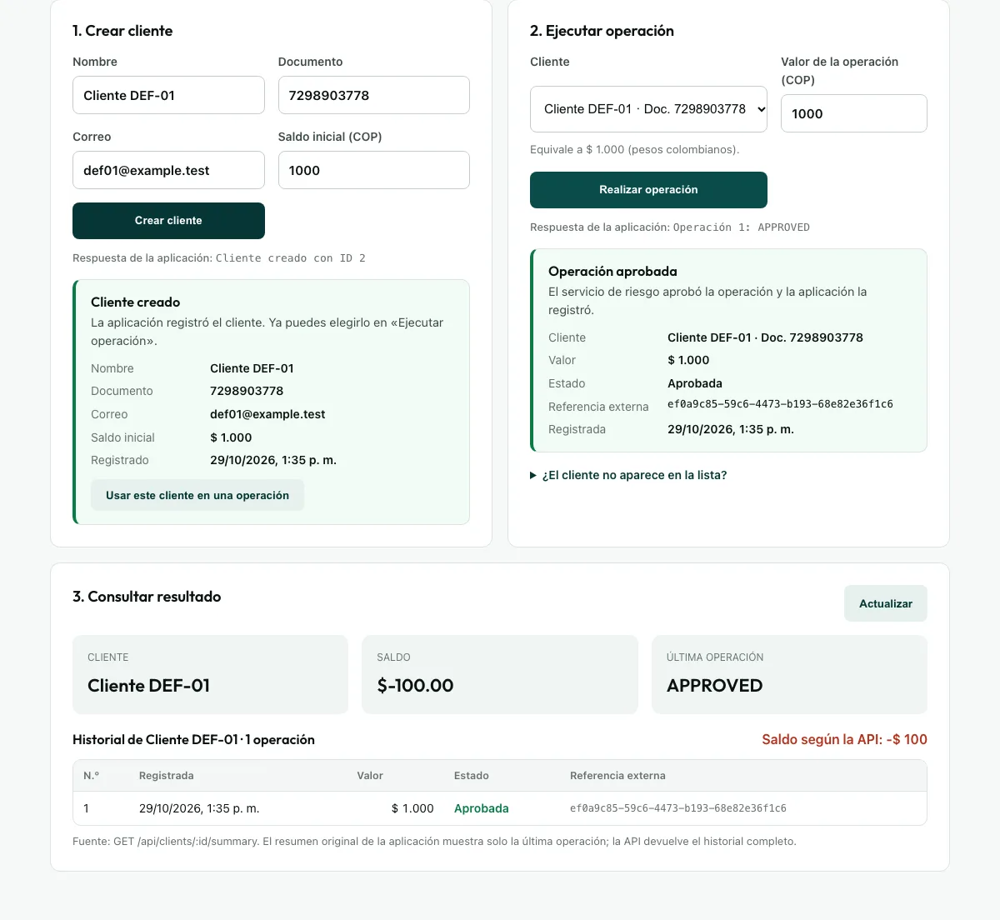
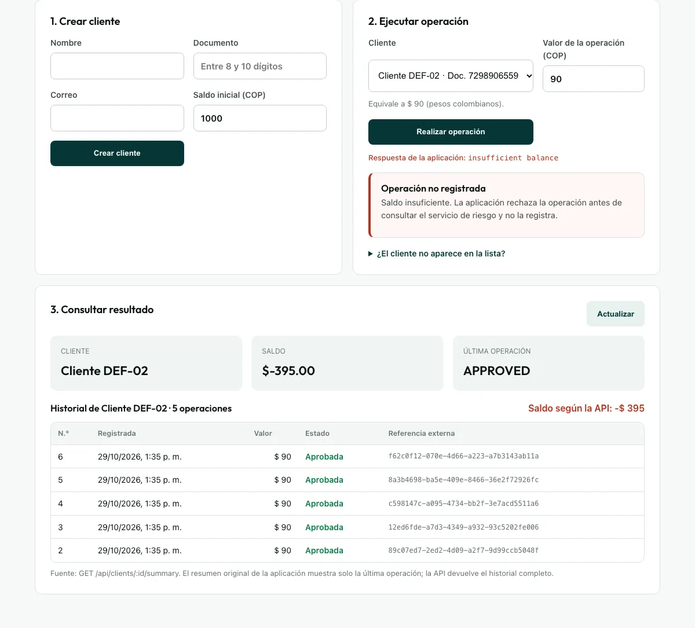

# Defectos abiertos del sistema bajo prueba

Encontré dos defectos de negocio que dejan saldos negativos. No los corregí: la prueba evalúa la calidad de una aplicación entregada, no su reparación. Los automaticé con `test.fail()`. Aparecen como «fallo esperado» en cada reporte y, si alguien los corrige, la prueba se pondrá en rojo para que la marca se retire de forma consciente.

| ID | Título | Severidad | Estado | Prueba automatizada |
|---|---|---|---|---|
| DEF-01 | Una operación aprobada puede dejar el saldo en negativo porque la validación no incluye el cargo del 10 % | Alta | Abierto | `tests/e2e/defectos-conocidos.spec.js` · «DEF-01 · Defecto abierto (fallo esperado)…» |
| DEF-02 | Operaciones simultáneas sobre un mismo cliente se aprueban todas y superan el saldo (doble gasto) | Crítica | Abierto | `tests/e2e/defectos-conocidos.spec.js` · «DEF-02 · Defecto abierto (fallo esperado)…» |

---

## DEF-01 · Una operación aprobada puede dejar el saldo en negativo porque la validación no incluye el cargo del 10 %

- **Estado:** abierto.
- **Severidad:** alta.
- **Reproducción:** siempre. No depende de la concurrencia ni del azar.

**Impacto.** Un cliente termina con saldo negativo sin que la aplicación lo advierta. Ocurre siempre que el valor de la operación cubre el saldo, pero el valor más el 10 % no lo cubre. Con saldo de 1 000 pasa con cualquier operación por encima de 909,09 y hasta 1 000.

**Regla de negocio afectada.** La aplicación rechaza una operación con `insufficient balance` cuando el saldo no la cubre, pero después descuenta el valor **más** un cargo del 10 %. La validación y el descuento usan montos distintos. El enunciado no menciona el cargo; lo conservé como comportamiento observado.

**Precondiciones.** El servicio de riesgo está configurado en «aprobado» (`RISK_MODE=approved`).

**Datos de prueba.**
- Saldo inicial: **1 000**.
- Valor de la operación: **1 000**.
- Cliente con documento único de 10 dígitos, generado por `tests/support/data-factory.js`.

**Pasos para reproducir.**
1. En «1. Crear cliente», registra un cliente con saldo inicial de 1 000.
2. En «2. Ejecutar operación», elige ese cliente y escribe 1 000 como valor.
3. Presiona «Realizar operación».
4. En «3. Consultar resultado», revisa el saldo y el historial. También puedes consultar `GET /api/clients/{id}/summary`.

**Resultado esperado.** La aplicación rechaza la operación por saldo insuficiente, porque el descuento total sería 1 100. El saldo nunca queda por debajo de cero.

**Resultado obtenido.** La operación se aprueba con HTTP 201 y el saldo queda en **−100**.

**Evidencia y trazabilidad.**
- Prueba automatizada: `tests/e2e/defectos-conocidos.spec.js`. En el reporte HTML de cada ejecución aparece como fallo esperado.
- Sondeo inicial por API: `evidencias/baseline/sondeo-defectos-api.txt`, con saldo de −100.
- Captura de la reproducción en la interfaz (29-oct-2026): `src/public/evidencias/def-01-interfaz.webp`.

**Observaciones y riesgos.** En `src/server.js`, la validación es `client.balance < amount` y el descuento es `amount + amount * 0.1`. La corrección depende de una decisión de negocio: validar contra el total que se descuenta o redefinir el cargo. Mientras no se decida, un saldo positivo no garantiza que la siguiente operación sea segura.

---

## DEF-02 · Operaciones simultáneas sobre un mismo cliente se aprueban todas y superan el saldo (doble gasto)

- **Estado:** abierto.
- **Severidad:** crítica.
- **Reproducción:** 5 de 5 intentos en la prueba de estabilidad.

**Impacto.** La pérdida no tiene límite: cada solicitud simultánea adicional vuelve a descontar. En la reproducción, un saldo de 100 terminó en −395, es decir, se descontaron 495. Basta con que lleguen solicitudes al mismo tiempo, algo que provocan los reintentos de red, un doble clic o una integración.

**Regla de negocio afectada.** El saldo debe validarse y descontarse como una sola operación. La aplicación valida el saldo, espera la respuesta del servicio de riesgo (entre 150 y 1 050 ms) y solo después descuenta. Durante esa espera, las demás solicitudes leen el mismo saldo, todavía sin el descuento.

**Precondiciones.**
- El servicio de riesgo está configurado en «aprobado» (`RISK_MODE=approved`).
- Se necesita acceso a la API, porque la interfaz envía una operación a la vez.

**Datos de prueba.**
- Saldo inicial: **100**.
- Cinco operaciones de **90**, enviadas al mismo tiempo.

**Pasos para reproducir.**
1. Crea un cliente con saldo de 100 mediante `POST /api/clients` y anota su ID.
2. Envía en paralelo cinco `POST /api/operations` con `{"clientId": ID, "amount": 90}`, por ejemplo con `Promise.all` o con cinco `curl` en segundo plano.
3. Consulta `GET /api/clients/ID/summary`.

**Resultado esperado.** Se aprueba una sola operación (90 más 9 de cargo) y el saldo queda en 1. Las otras cuatro se rechazan por saldo insuficiente.

**Resultado obtenido.** Las cinco operaciones se aprueban con HTTP 201, quedan cinco registros y el saldo termina en **−395**.

**Evidencia y trazabilidad.**
- Prueba automatizada: `tests/e2e/defectos-conocidos.spec.js`.
- Reproducción en las 5 repeticiones: `evidencias/e2e/estabilidad-repeat-each-5-15.txt`.
- Sondeo inicial por API: `evidencias/baseline/sondeo-defectos-api.txt`.
- Captura (29-oct-2026): `src/public/evidencias/def-02-interfaz.webp`. Envié las cinco operaciones en paralelo por API. Para cargar el resumen en la interfaz intenté una sexta operación de 90, que la aplicación rechazó por saldo insuficiente porque el saldo ya era −395.

**Observaciones y riesgos.** La persistencia es un archivo JSON que se lee y se reescribe completo, sin bloqueo. La corrección requiere que la validación y el descuento sean atómicos, por ejemplo con un bloqueo por cliente o con una transacción en una base de datos real. Es el defecto que bloquearía una salida a producción.

---

## Otros hallazgos (fuera de estos dos defectos)

`DIAGNOSTICO.md` registra además:
- Saldo inicial negativo o no numérico aceptado.
- Correo sin validación de formato.
- XSS por `innerHTML` en el resumen original.
- Servicio de riesgo que no valida el token.

Quedaron como pendientes, fuera del alcance mínimo de la prueba.
