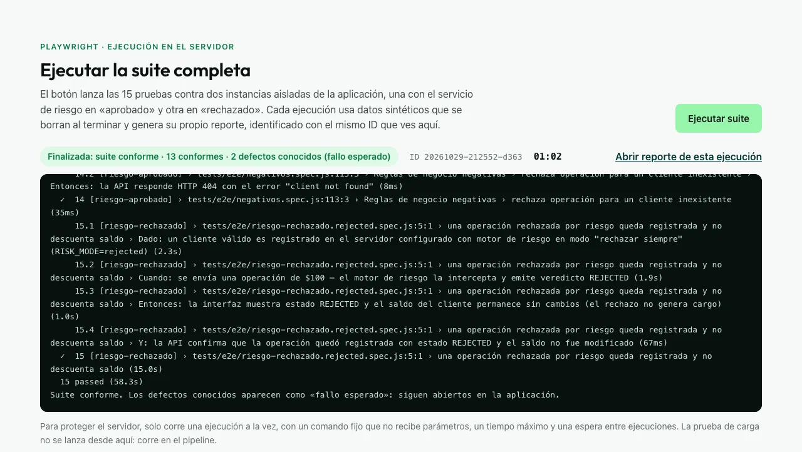
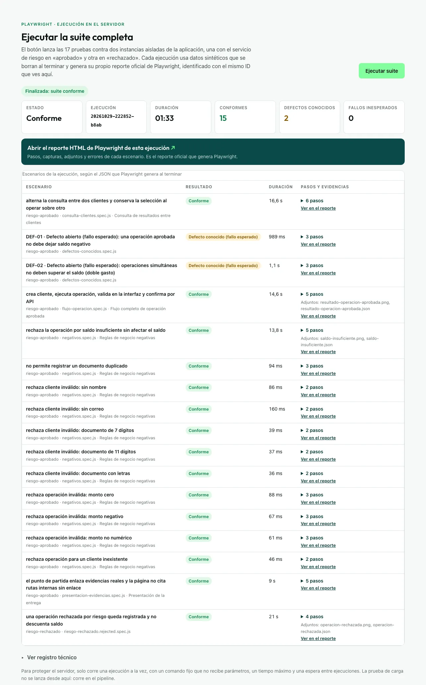

# Despliegue en el VPS de Qirava (29-oct-2026)

Todas las cifras de este documento se midieron en el servidor real. No incluye valores de secretos.

## Servidor (inspección previa, solo lectura)

| Recurso | Valor medido |
|---|---|
| Proveedor y sistema | DigitalOcean, Ubuntu 24.04, systemd 255, cgroup v2 |
| CPU | 1 vCPU |
| RAM | 961 MiB en total; 450 a 470 MiB disponibles con las apps de Qirava en marcha |
| Swap | 2 047 MiB (170 MiB en uso antes de instalar) |
| Disco | 24 GB; 7,7 GB libres (67 % usado) |
| Servicios existentes | Contenedores `qirava-portal-qirava-portal-1` (149 MiB) y `qirava-portal-caddy-1` (15 MiB), ambos activos desde hace 3 semanas |
| Firewall del host | Política `INPUT ACCEPT` y ufw inactivo |
| Caddy | Docker Compose en `/opt/qirava-portal`; un sitio (`qirava.co`, con redirección `www`); certificados de Let's Encrypt |

## Decisiones derivadas de la inspección

- **Memoria.** El perfil inicial (700M sin swap) no cabía en 961 MiB. Dejé el servicio con `MemoryHigh=380M`, `MemoryMax=520M` y `MemorySwapMax=600M`: por encima de 380M, el kernel recupera y pasa a swap primero las páginas de este servicio y no las del portal. Además, el ejecutor no lanza Chromium si el servidor tiene menos de 350 MiB libres.
- **Red.** Como el host no tiene firewall y `server.js` (archivo del evaluador) escucha en `0.0.0.0`, limité el servicio con `IPAddressDeny=any` e `IPAddressAllow=localhost 172.16.0.0/12`. El filtro aplica solo a este servicio, incluidos los servidores de prueba en 4310 y 4311, y no toca el firewall compartido.
- **Fuente tipográfica.** El filtro de red reveló que la página dependía de Google Fonts. La fuente Outfit se sirve ahora desde la aplicación (commit `43f6f52`).
- **Caddy.** Si el bloque nuevo no valida, el instalador restaura el respaldo antes de salir (commit `e33bc04`).

Cada cambio pasó primero por el simulacro de GitHub Actions, que reproduce esa topología. En la ejecución `40933707161`, con el mismo perfil de memoria, la suite dio 13 conformes y 2 defectos conocidos, con un pico de 381,8 MiB, y el puerto 3300 no respondió desde fuera de la red de Caddy.

## Instalación

- **Comando:** `ssh root@206.81.7.100 'bash -s -- e33bc04' < deploy/instalar-en-vps.sh`. Terminó con código 0.
- **Servicio:** `periferia-qe` quedó activo (`high 380M · max 520M · swap max 600M`).
- **Caddy:** el diff del Caddyfile contra su respaldo solo muestra el bloque nuevo al final. Caddy recargó sin reiniciar el contenedor.
- **Desde Internet:** `http://206.81.7.100:3300/health` no responde.
- **Servicios existentes después de instalar:** `https://qirava.co/` → 200 y `https://www.qirava.co/` → 301, igual que antes. Ambos contenedores siguen activos.

## Ejecución real de la suite en el VPS

La lancé desde la página desplegada, presionando el botón con Playwright a través de un túnel SSH a `127.0.0.1:3300`, porque el DNS todavía no existía.

| Medición | Resultado |
|---|---|
| ID de la ejecución | `20261029-185108-9328` |
| Resultado | `passed`: 13 conformes, 2 defectos conocidos (DEF-01 y DEF-02), 0 fallidas |
| Duración | 62 s (25 s en el simulacro de CI, con más CPU y RAM) |
| Reporte | `/revision/ejecuciones/20261029-185108-9328/reporte/`, 543 KB, HTTP 200 |
| Procesos huérfanos en 4310 y 4311 | 0 |
| Memoria del servicio | Pico de cgroup de 380 MiB; hasta 360 MiB en swap propio |
| Memoria disponible del servidor | Mínimo de 241 MiB durante la ejecución; volvió a unos 519 MiB al terminar |
| Carga del sistema | Máximo de 2,57 (promedio de 1 minuto, 1 vCPU) |
| `qirava.co` durante la ejecución | 50 de 50 respuestas HTTP 200; promedio de 0,64 s y máximo de 1,64 s (antes de instalar: 0,37 a 0,82 s) |

**Lectura.** El droplet de 1 GB aloja la suite sin errores en el portal, pero con poco margen: durante la ejecución el portal responde más lento, y la ejecución tarda más del doble que en CI porque el servicio trabaja con swap. Justo después de una ejecución, la primera carga del reporte puede tardar mientras el proceso recupera memoria del swap; en una consulta posterior tardó 1,3 s. Si la página va a recibir uso frecuente, la medida correcta es ampliar el droplet a 2 GB. Es una decisión de costo del propietario.

## Publicación y ejecución desde Internet

El propietario creó el registro DNS `A prueba-tecnica-qa-lead-periferia-it → 206.81.7.100` en Cloudflare, con proxy. Antes del certificado, Cloudflare respondía 525 (sin TLS en el origen). Forcé una recarga de Caddy, que resolvió el desafío HTTP-01 a través del proxy y obtuvo el certificado de Let's Encrypt. No toqué la configuración de los demás dominios.

| Comprobación desde Internet | Resultado |
|---|---|
| `https://prueba-tecnica-qa-lead-periferia-it.qirava.co/health` | HTTP 200 `{"status":"ok"}`, servido por Cloudflare |
| `/` y `/revision/estado` | HTTP 200; ejecutor en modo `public` |
| `http://206.81.7.100:3300/health` | Sin respuesta (el servicio sigue aislado) |
| Commit servido durante la ejecución | `f522eb9` (después redesplegué commits que solo cambian documentación) |

La suite se lanzó presionando «Ejecutar suite» en la página pública, sin túnel:

| Medición | Resultado |
|---|---|
| ID de la ejecución | `20261029-212552-d363` |
| Resultado | `passed`, código 0: 13 conformes, 2 defectos conocidos (DEF-01 y DEF-02), 0 fallidas, 0 inestables |
| Duración | 62 s en el servidor |
| Reporte | `/revision/ejecuciones/20261029-212552-d363/reporte/`, 543 KB, HTTP 200; el título contiene el mismo ID |
| Errores de consola en la página | 0 |
| Procesos huérfanos en 4310 y 4311 | 0 |
| Memoria del servicio | Pico de cgroup de 380 MiB; hasta 357 MiB en swap propio |
| Memoria disponible del servidor | Mínimo de 234 MiB |
| Carga máxima (1 min) | 2,17 |
| `qirava.co` durante la ejecución | 50 de 50 respuestas HTTP 200; promedio de 0,34 s y máximo de 0,46 s |
| Contenedores existentes después | `qirava-portal` (healthy) y `caddy`, activos |

## Ejecución pública con los ajustes de cierre (commit `859e04b`)

Después de agregar la consulta entre clientes, la presentación de resultados, el pie y las evidencias enlazadas, desplegué `859e04b` y volví a ejecutar la suite con el botón de https://prueba-tecnica-qa-lead-periferia-it.qirava.co.

| Medición | Resultado |
|---|---|
| ID de la ejecución | `20261029-222852-b8ab` |
| Resultado | Conforme: 17 escenarios, 15 conformes, 2 defectos conocidos (DEF-01 y DEF-02), 0 fallos inesperados |
| Duración | 93 s (límite del ejecutor: 180 s) |
| Reporte | El título contiene el mismo ID; el enlace «Ver en el reporte» de DEF-02 abre ese escenario con sus pasos |
| Registro técnico | Contraído al terminar, bajo «Ver registro técnico» |
| Procesos huérfanos | 0 |
| Memoria del servicio | Pico de cgroup de 380 MiB; hasta 379 MiB en swap propio |
| Memoria disponible del servidor | Mínimo de 240 MiB |
| Carga máxima (1 min) | 2,91 |
| `qirava.co` durante la ejecución | 50 de 50 respuestas HTTP 200; promedio de 0,34 s y máximo de 0,45 s |

**Enlaces de la página, comprobados desde Internet:**
- Evidencias y documentos internos: todos responden 200 con el tipo esperado.
- `/evidencias/baseline/`: redirige al catálogo de evidencias.
- GitHub y qirava.co: responden 200.
- LinkedIn: responde 999 a clientes automatizados, así que solo se comprobó la redirección 301 hacia `/in/libanielvargas`.
- Correo: Cloudflare ofuscaba el `mailto:`. Lo corregí con las marcas `email_off`, y ahora el enlace llega intacto.

**Lectura:** con 17 pruebas, la ejecución tarda unos 30 s más que con 15, porque el servicio trabaja con swap en el droplet de 1 GB. Quedan unos 87 s de margen antes del límite. El portal no se degradó durante la ejecución.

